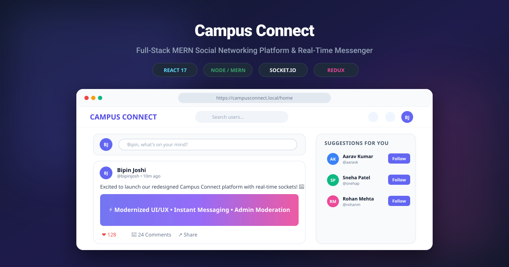
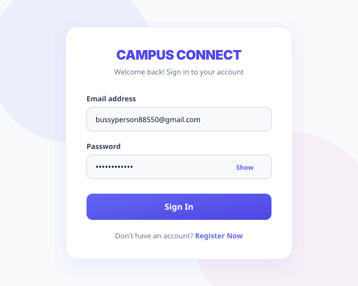
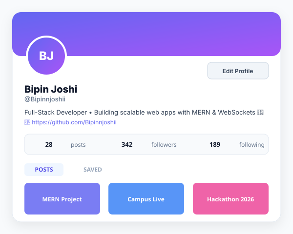
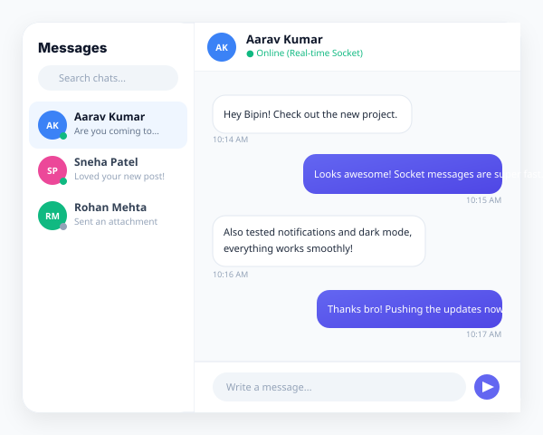
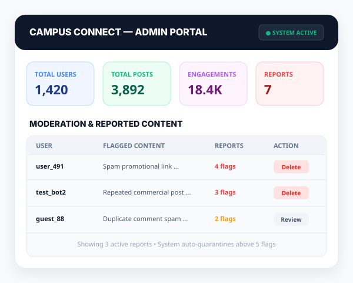

# Campus Connect — Full-Stack MERN Social Media Platform

<p align="center">
  
</p>

<p align="center">
  
  
  
  
  
  
</p>

---

## 📌 Overview

**Campus Connect** is a feature-rich, modern social media and communication platform engineered using the **MERN** stack (MongoDB, Express, React, Node.js) with real-time interactivity powered by **Socket.io**. 

The platform delivers a streamlined, modern social networking experience featuring JWT-based authentication, post creation with camera/image uploads, threaded comments with nested replies, real-time 1-on-1 direct messaging, instant notifications with sound alerts, profile management, and a dedicated **Admin Moderation Portal** for community safety.

---

## 📸 Application Interface & Previews

<div align="center">

| Authentication & Sign In | User Profile & Connections |
| :---: | :---: |
|  |  |

| Real-Time Messenger | Admin Moderation Dashboard |
| :---: | :---: |
|  |  |

</div>

---

## ✨ Features & Capabilities

### 👤 Social Interaction & User Experience
- **Authentication & Security:** Secure registration and login flow utilizing salted password hashing (`bcrypt`) and dual-token JWT verification (short-lived access tokens and refresh tokens stored in HTTP-only cookies).
- **Post Creation & Media Support:**
  - Create, edit, and delete multimedia posts with captions and imagery.
  - In-browser camera capture or direct file-picker uploads.
  - Multi-image carousel presentation.
- **Social Engagement:**
  - Dynamic like/unlike interactions.
  - Nested comments and threaded replies with individual comment likes.
  - Dynamic post sharing and clipboard link copy.
  - Save posts into private user collections.
- **Discovery & Navigation:**
  - **Explore Feed:** Discover trending content and posts from across the network.
  - **Dynamic Search:** Real-time user search by username and display name.
  - **Automated Suggestions:** Algorithmic suggestions to discover new peers.
  - **Infinite Scroll / Pagination:** Smooth pagination across feeds, explore views, and comments.
- **Real-Time WebSockets (`Socket.io`):**
  - Instantaneous 1-on-1 direct messaging.
  - Live socket notifications for likes, comments, follows, and messages with audio triggers.
  - Online/offline presence indicators.
- **Modern Design & Theming:**
  - Responsive, glassmorphic navigation header with blur filters.
  - Clean card-based layout with soft elevations and smooth hover states.
  - Built-in Dark Mode with natural true-color media preservation.
- **Safety & Moderation:**
  - User post reporting system to flag spam or inappropriate content.

---

### 🛡️ Admin Moderation Dashboard
- **Platform Analytics:** Real-time metrics tracking total users, posts, community engagements, and active spam flags.
- **Content Moderation:** Dedicated review table for community-reported content.
- **Administrative Moderation:** Direct review and deletion of reported spam content.
- **Role Assignment:** Ability to provision and grant administrative permissions.

---

## 🛠️ Tech Stack & Architecture

| Layer | Technologies |
|---|---|
| **Frontend** | React 17, Redux, Redux Thunk, React Router v5, Material-UI, Bootstrap 5, Socket.io-client, Axios, Moment.js, Emoji-Mart |
| **Backend** | Node.js, Express.js, Socket.io, Mongoose, JWT (`jsonwebtoken`), bcrypt, cookie-parser, cors |
| **Database** | MongoDB / MongoDB Atlas |
| **Media Hosting** | Cloudinary (Camera and file upload pipeline) |

---

## 🚀 Getting Started

Follow the steps below to set up and run Campus Connect locally.

### Prerequisites
- [Node.js](https://nodejs.org/) (v14 or higher)
- [MongoDB](https://www.mongodb.com/) (Local instance or [MongoDB Atlas](https://www.mongodb.com/cloud/atlas))
- [Cloudinary Account](https://cloudinary.com/) (Free tier for media uploads)
- `npm` or `yarn`

---

### 1. Clone the Repository
```bash
git clone https://github.com/Bipinnjoshii/Social-media-chat-app.git
cd Social-media-chat-app
```

---

### 2. Configure Environment Variables
Copy the `.env.example` file to create your local `.env`:

```bash
cp .env.example .env
```

Set the required environment keys in `.env`:
```env
PORT=8080
MONGODB_URL=mongodb://localhost:27017/mern
ACCESS_TOKEN_SECRET=your_jwt_access_token_secret
REFRESH_TOKEN_SECRET=your_jwt_refresh_token_secret
```

---

### 3. Configure Cloudinary
To enable image and camera uploads, add your Cloudinary credentials in:
`client/src/utils/imageUpload.js`

```javascript
formData.append("upload_preset", "YOUR_CLOUDINARY_UPLOAD_PRESET");
formData.append("cloud_name", "YOUR_CLOUDINARY_CLOUD_NAME");

const res = await fetch("https://api.cloudinary.com/v1_1/YOUR_CLOUDINARY_CLOUD_NAME/image/upload", {
    method: "POST",
    body: formData
});
```

---

### 4. Install Dependencies

#### Backend Dependencies (Root Directory)
```bash
npm install
```

#### Frontend Dependencies (Client Directory)
```bash
cd client
npm install
cd ..
```

---

### 5. Run the Application

#### Start Backend Server
In the root directory:
```bash
npm start
# or for hot reloading during development:
npm run dev
```
> Server runs on `http://localhost:8080`.

#### Start Frontend Client
In a separate terminal:
```bash
cd client
npm start
```
> React client launches at `http://localhost:3000`.

---

## 📂 Project Structure

```text
├── client/                     # Frontend React application
│   ├── public/                 # Static assets & HTML template
│   └── src/
│       ├── audio/              # Notification audio files
│       ├── components/         # Reusable React components (Feed, Navbar, Cards, Modals)
│       ├── customRouter/       # Protected route handling
│       ├── images/             # Icons and UI images
│       ├── pages/              # App pages (Home, Login, Register, Profile, Messages, Admin)
│       ├── redux/              # Redux store, actions, and reducers
│       ├── styles/             # Modular CSS stylesheets (Modern Design System)
│       └── utils/              # API helpers, validation, and Cloudinary uploads
├── controllers/                # Backend route controllers (Auth, Posts, Users, Comments, Messages, Admin)
├── middleware/                 # Authentication middleware (JWT verification)
├── models/                     # Mongoose database models (User, Post, Comment, Message, Conversation, Notification)
├── routes/                     # Express API endpoint definitions
├── screenshots/                # Vector UI preview mockups & banner
├── .env.example                # Sample environment configuration
├── .gitignore                  # Git ignore rules
├── package.json                # Backend dependencies, metadata, and scripts
├── server.js                   # Express application entry point & MongoDB connection
└── socketServer.js             # Socket.io real-time event handlers
```

---

## 👤 Author

- **Bipin Joshi** — [@Bipinnjoshii](https://github.com/Bipinnjoshii)

---

## 📄 License
This project is licensed under the [MIT License](LICENSE) - &copy; 2026 Bipin Joshi.
