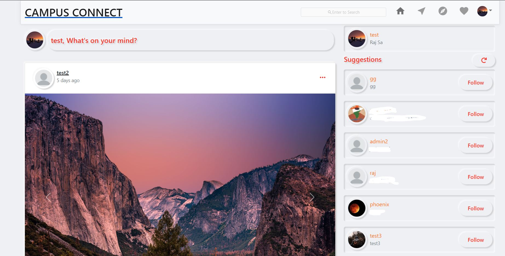
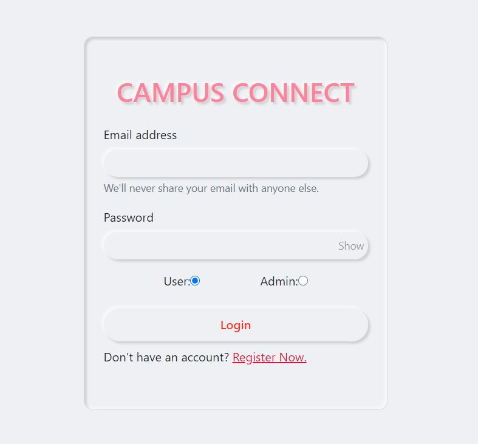
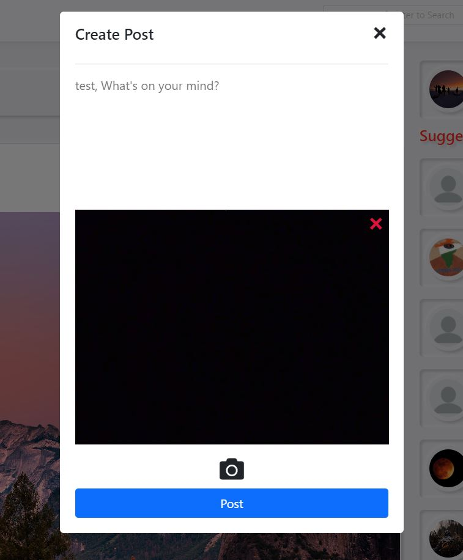
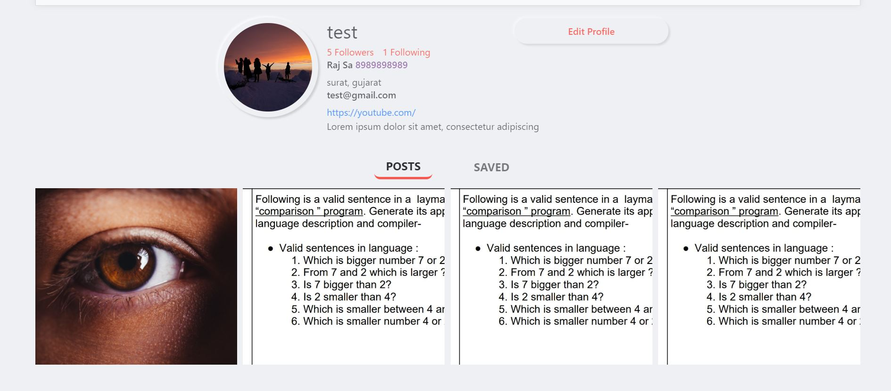
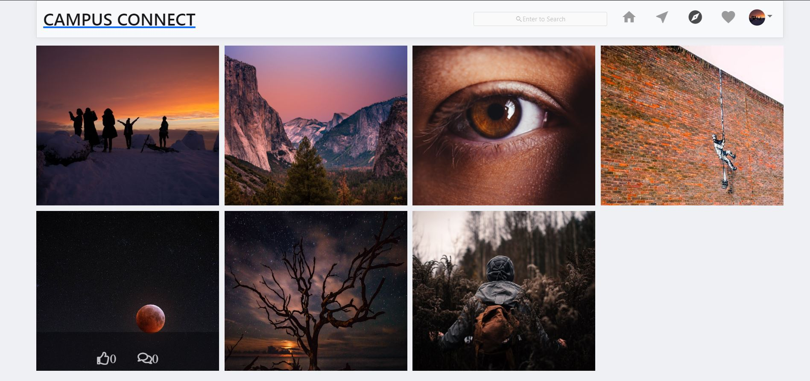
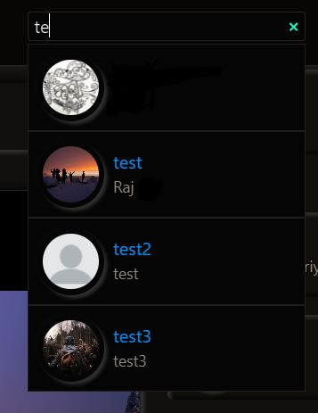
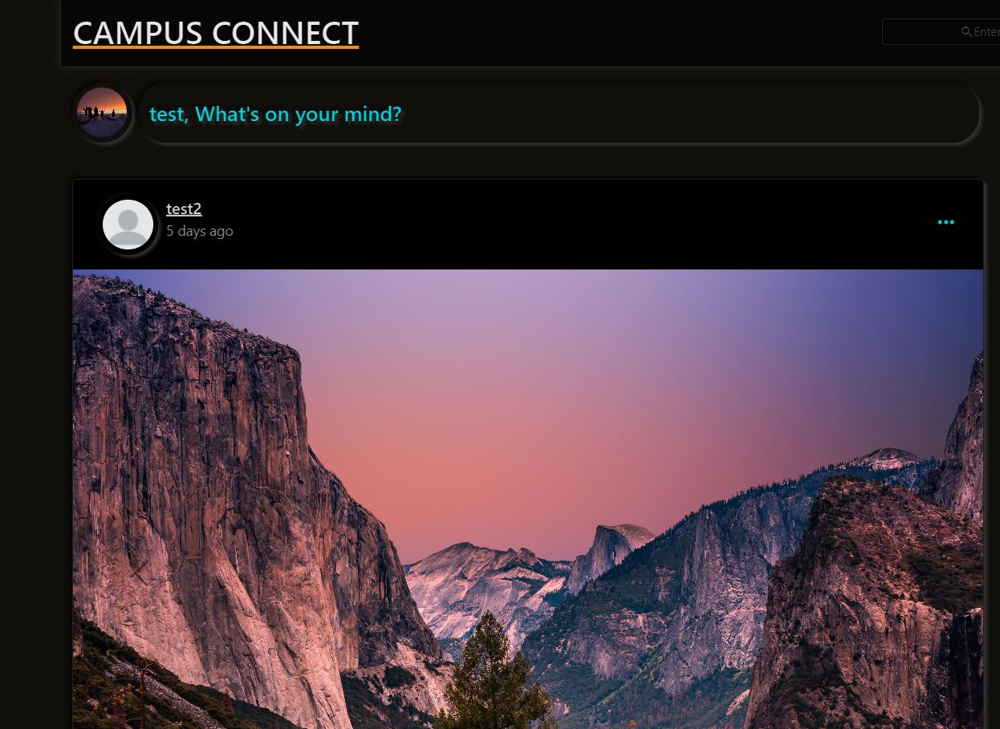
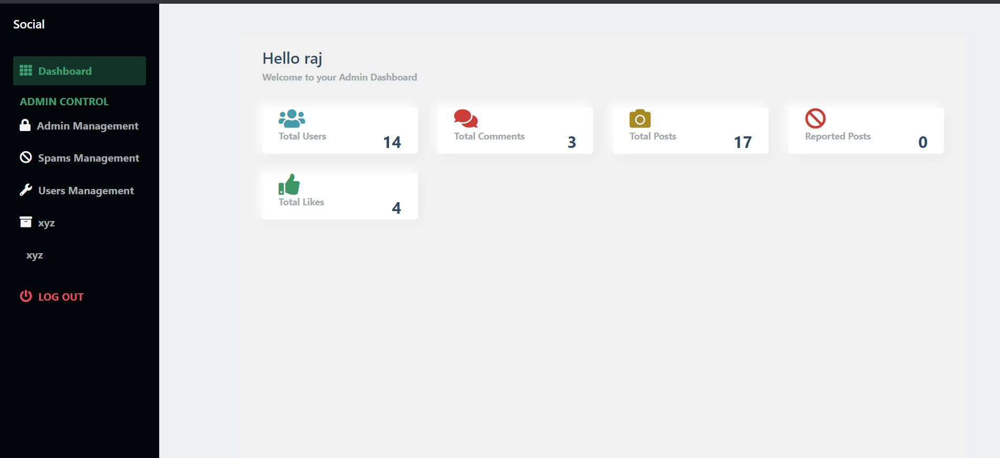

# Campus Connect — Full-Stack MERN Social Media Platform

<p align="center">
  
</p>

<p align="center">
  
  
  
  
  
  
</p>

---

## 📌 Overview

**Campus Connect** is a feature-rich, fully responsive social media web application developed with the **MERN** stack (MongoDB, Express, React, Node.js) and powered by **Socket.io** for real-time interactions. 

The platform provides a comprehensive social networking experience featuring user authentication, post creation with camera/image uploads, comments with nested replies, real-time messaging, notifications, profile customization, a dark/light mode toggle, and a dedicated **Admin Dashboard** for community moderation.

---

## ✨ Features

### 👤 User Experience & Interaction
- **Authentication & Security:** User registration and login protected with encrypted passwords (bcrypt) and JSON Web Tokens (access & refresh tokens).
- **Post Creation & Uploads:**
  - Create, edit, and delete posts with text captions and images.
  - Image capture support directly from device camera or local file system.
  - Multi-image carousel display.
- **Social Engagement:**
  - Like and unlike posts.
  - Comment on posts with support for nested replies and comment likes.
  - Share post links or copy direct link to clipboard.
  - Save posts into private collections for later viewing.
- **Discovery & Navigation:**
  - **Explore Page:** Discover posts and trending content from across the platform.
  - **User Search:** Search other users dynamically by username.
  - **Suggestions:** Automated user recommendation sidebar to grow connections.
  - **Pagination:** Infinite-scroll/load-more pagination across home feed, explore, and comments.
- **Real-Time Communication:**
  - Real-time 1-on-1 direct messaging powered by **Socket.io**.
  - Instant notifications for likes, comments, follows, and messages with audio alerts.
  - Online/offline presence indicators.
- **Profile & Personalization:**
  - User profile with follower and following counters and listings.
  - Grid view of user posts, saved posts, and tagged content.
  - Edit profile information (avatar, bio, contact, website).
  - Built-in **Dark Mode** toggle for comfortable browsing in any lighting condition.
- **Safety & Moderation:**
  - Report inappropriate posts for spam or violations.

---

### 🛡️ Admin Dashboard
- **Platform Analytics:** Real-time statistics displaying total users, posts, comments, likes, and spam reports.
- **Content Moderation:** Dedicated review panel for posts flagged/reported by community members.
- **Administrative Actions:** Delete reported spam content and manage platform integrity.
- **Role Management:** Capability for administrators to create or assign administrative privileges to other users.

---

## 🛠️ Tech Stack

| Layer | Technologies |
|---|---|
| **Frontend** | React 17, Redux, Redux Thunk, React Router v5, Material-UI, Bootstrap 5, Socket.io-client, Axios, Moment.js, Emoji-Mart |
| **Backend** | Node.js, Express.js, Socket.io, Mongoose, JWT (jsonwebtoken), bcrypt, cookie-parser, cors |
| **Database** | MongoDB / MongoDB Atlas |
| **Cloud Storage** | Cloudinary (Media & Image Uploads) |

---

## 📸 Application Previews

<div align="center">

| Login & Authentication | Home Feed & Interactions |
| :---: | :---: |
|  |  |

| Post Creation & Camera Upload | User Profile & Follows |
| :---: | :---: |
|  |  |

| Explore Feed | User Search |
| :---: | :---: |
|  |  |

| Dark Mode Interface | Admin Dashboard & Moderation |
| :---: | :---: |
|  |  |

</div>

---

## 🚀 Getting Started

Follow the steps below to set up and run the project locally.

### Prerequisites
- [Node.js](https://nodejs.org/) (v14 or higher recommended)
- [MongoDB](https://www.mongodb.com/) (Local installation or [MongoDB Atlas](https://www.mongodb.com/cloud/atlas))
- [Cloudinary Account](https://cloudinary.com/) (Free tier for media uploads)
- `npm` or `yarn`

---

### 1. Clone the Repository
```bash
git clone https://github.com/Bipinnjoshii/Social-media-chat-app.git
cd Social-media-chat-app
```

---

### 2. Configure Environment Variables
Create a `.env` file in the root directory by copying the example template:

```bash
cp .env.example .env
```

Populate `.env` with your credentials:
```env
PORT=8080
MONGODB_URL=mongodb://localhost:27017/mern
ACCESS_TOKEN_SECRET=your_jwt_access_token_secret
REFRESH_TOKEN_SECRET=your_jwt_refresh_token_secret
```

---

### 3. Configure Cloudinary
To enable image and camera uploads, add your Cloudinary details in:
`client/src/utils/imageUpload.js`

```javascript
formData.append("upload_preset", "YOUR_CLOUDINARY_UPLOAD_PRESET");
formData.append("cloud_name", "YOUR_CLOUDINARY_CLOUD_NAME");

const res = await fetch("https://api.cloudinary.com/v1_1/YOUR_CLOUDINARY_CLOUD_NAME/image/upload", {
    method: "POST",
    body: formData
});
```

---

### 4. Install Dependencies

#### Install Backend Dependencies (Root Directory)
```bash
npm install
```

#### Install Frontend Dependencies (Client Directory)
```bash
cd client
npm install
cd ..
```

---

### 5. Run the Application

#### Start Backend Server
In the root directory:
```bash
npm start
# or for live reloading during development:
npm run dev
```
> The backend server will start on `http://localhost:8080`.

#### Start Frontend Client
In a separate terminal window, navigate to the `client` folder:
```bash
cd client
npm start
```
> The React app will launch automatically at `http://localhost:3000`.

---

## 📂 Project Structure

```text
├── client/                     # Frontend React application
│   ├── public/                 # Static assets & HTML template
│   └── src/
│       ├── audio/              # Notification audio files
│       ├── components/         # Reusable React components (Feed, Navbar, Cards, Modals)
│       ├── customRouter/       # Protected route handling
│       ├── images/             # Icons and UI images
│       ├── pages/              # App pages (Home, Login, Register, Profile, Messages, Admin)
│       ├── redux/              # Redux store, actions, and reducers
│       ├── styles/             # Modular CSS stylesheets
│       └── utils/              # API helpers, validation, and Cloudinary uploads
├── controllers/                # Backend route controllers (Auth, Posts, Users, Comments, Messages, Admin)
├── middleware/                 # Authentication middleware (JWT verification)
├── models/                     # Mongoose database models (User, Post, Comment, Message, Conversation, Notification)
├── routes/                     # Express API endpoint definitions
├── screenshots/                # Application UI preview screenshots
├── .env.example                # Sample environment configuration
├── .gitignore                  # Git ignore rules
├── package.json                # Backend dependencies, metadata, and scripts
├── server.js                   # Express application entry point & MongoDB connection
└── socketServer.js             # Socket.io real-time event handlers
```

---

## 👤 Author

- **Bipin Joshi** — [@Bipinnjoshii](https://github.com/Bipinnjoshii)

---

## 📄 License
This project is licensed under the [MIT License](LICENSE) - &copy; 2026 Bipin Joshi.
